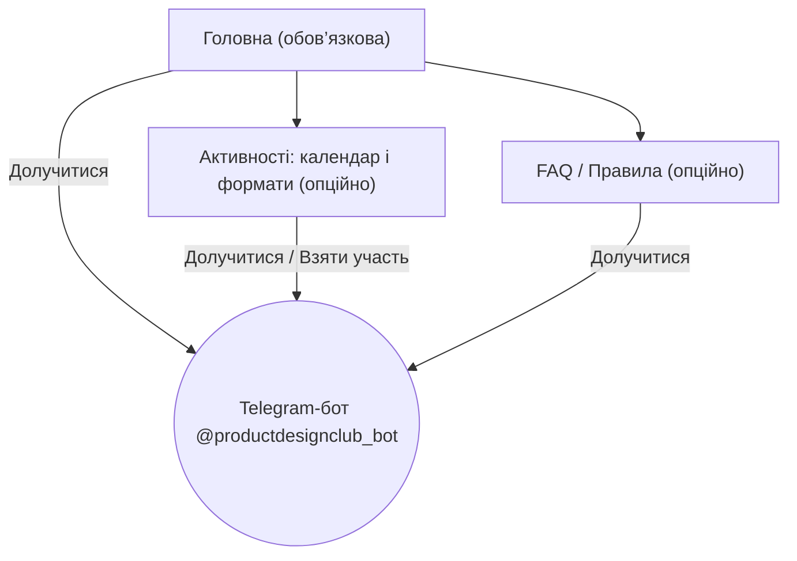

# Структура та IA: сайт Product Design Club

> **Статус:** draft — на затвердження
> **Оновлено:** 2026-11-17
> **Базується на:** `00-brief.md` (мінімум — головна; desktop + mobile; реєстрації на сайті немає), `insights.md`, `jtbd.md`. Готової структури в брифі немає `[бриф]`, тож це **пропозиція**.

## Контент: що обов’язково, що бажано, що можна прибрати

Тексти й фото про клуб ще уточнюються `[бриф]`; нижче — структура, не копірайт.

| Пріоритет | Блок | Навіщо | Звідки |
|---|---|---|---|
| Обов’язково | Що це за клуб і для кого | J1 | `[бриф]` «Що це за клуб» |
| Обов’язково | Активності (5 штук, з коротким описом) | J4 | `[бриф]` |
| Обов’язково | Як долучитись: 3 кроки + кнопка в бот | J2, основна дія | `[бриф]`, I2 |
| Обов’язково | Перша мала дія (найближча дизайн-кава) | J3 | I1 |
| Бажано | Атмосфера: фото/відео живих зустрічей, «хто вже в клубі» | J1 | `[бриф]` «Яка атмосфера» |
| Бажано | Скільки людей і як росте (достовірні цифри) | довіра | `[метрики]` |
| Бажано | FAQ: що з анкетою, чи платно, чи можна мовчати | J2, I6 | `(припущення)` |
| Бажано | Блок «Для своїх»: календар, правила | J6 | R6 |
| Можна прибрати | Менторство як окрема сторінка | поза брифом | `[бриф]` |
| Можна прибрати | Вакансії / пошук роботи | не підтверджено R5 | I5 |

## Sitemap

Мінімум — головна. Пропозиція для більшого обсягу (кількість сторінок не оцінюється `[бриф]`):

## Порядок блоків головної (гіпотеза)

| # | Блок | Відповідає на |
|---|---|---|
| 1 | Hero: «Що це за клуб» одним реченням + CTA «Долучитися» + 3 кроки | J1, J2 |
| 2 | Активності: 5 карток, перша — дизайн-кава | J4 |
| 3 | Перша мала дія: найближча дизайн-кава | J3, J5 |
| 4 | Атмосфера і люди: фото, «хто в клубі» (роль/рівень без імен) | J1 |
| 5 | Як долучитись детально (бот → знайомство → правила; анкета необов’язкова) | J2 |
| 6 | FAQ | I6 |
| 7 | Блок «Для своїх» (якщо підтвердить R6) | J6 |
| 8 | Фінальна CTA + footer | основна дія |

## Навігація

Одна основна дія на екрані (`Долучитися`). Меню: Клуб, Активності, FAQ; без пунктів, яких немає. Окремої сторінки менторства немає: це поза брифом.

## Mobile

Той самий порядок. Sticky-CTA «Долучитися», бо основна дія — перехід у Telegram, а mobile — ймовірний пристрій входу `(припущення)`.

## Що вирішують розмови

R1 визначає акценти hero; R6 — чи є блок 7.
