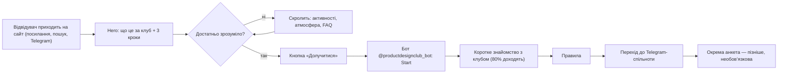
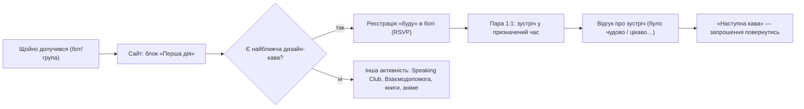
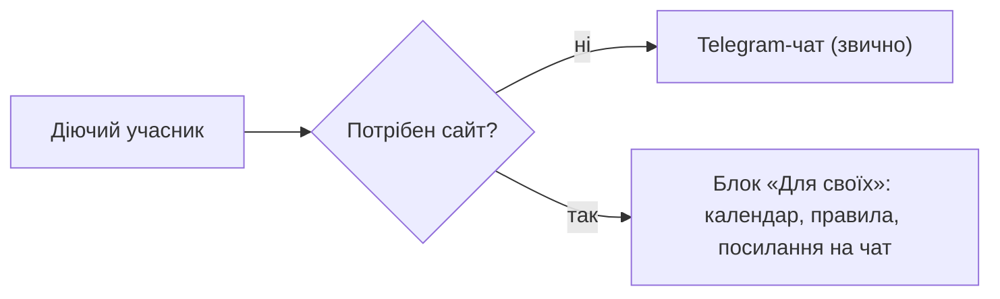

# Сценарії відвідувача (user flows): сайт Product Design Club

> **Статус:** draft — на затвердження
> **Оновлено:** 2026-11-17
> **Базується на:** `00-brief.md` (flow долучення через бот), `jtbd.md`, `insights.md`.

Для кожного сценарію: з яким запитанням приходить людина → що робить → де можна втратити.

## F1. Долучитись до клубу (J1, J2) — основний

З яким запитанням: «Що це за місце і чи мені туди?»

Де втрачаємо: C (не зрозуміло, що буде — I2), між F і G (169 людей не дійшли до кінця знайомства `[метрики]`). Метрики: `cta_join_click`, `/start`, частка 80% → 79% → 25%.

## F2. Перша участь (J3, J4, J5)

З яким запитанням: «Що мені зробити зараз, коли я вже долучився?»

Де втрачаємо: A → D (641 не брали участі), E (31 зустріч не відбулася, 15 партнер не відповів `[метрики]`), G (50% не повертаються).

## F3. Діючий учасник повертається за інформацією (J6)

З яким запитанням: «Коли найближча активність і які правила?»

Відкрите питання R6: чи цей сценарій реальний. Якщо ні — блок прибираємо.

## Ризики сценаріїв

| Ризик | Сценарій | Інсайт |
|---|---|---|
| Людина не розуміє, що долучення триває в Telegram | F1 | I2 |
| Людина долучилась, але не бере участі | F2 | I1 |
| Людина не повертається на дизайн-каву | F2 | I3 |
| Сайт дублює чат | F3 | I10 |
